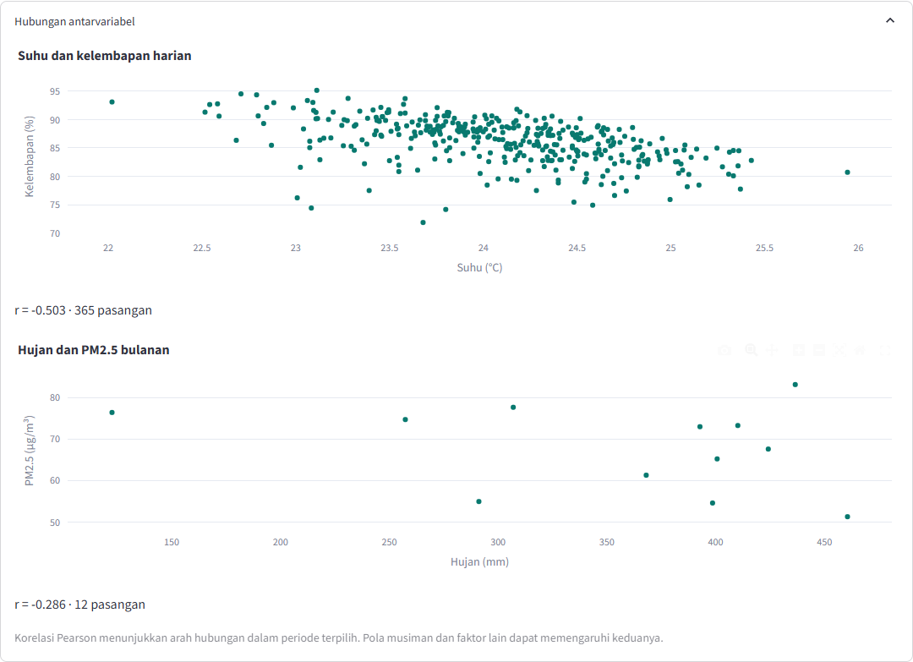
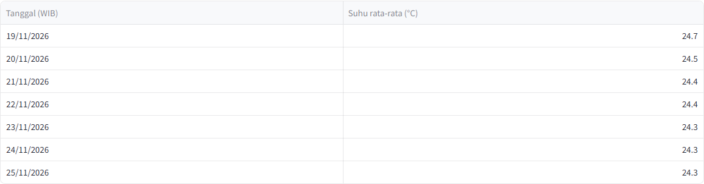
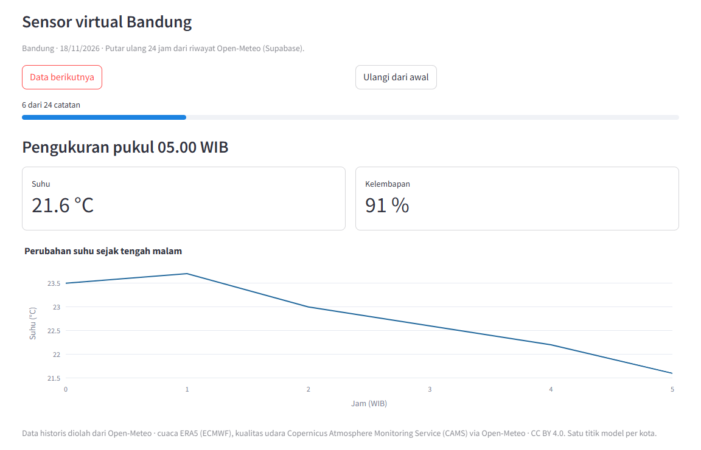

# Dashboard Cuaca Kota Berbasis Cloud

*Laporan akhir Telematika · 18 November 2026*
*Studi Bandung dengan pembanding Jakarta dan Surabaya · Topik 6, Smart City Dashboard Sederhana*

| Anggota | NPM | Kelas |
|---|---|---|
| Noell Valentino Timothy | 140810240064 | B |
| Sebastian Augustino Lie | 140810240076 | B |
| Newten Putra Santoso | 140810240090 | B |

Teknik Informatika, FMIPA Universitas Padjadjaran

## 1. Latar belakang

Pada minggu pertama kami ingin mengetahui kapan hujan paling banyak turun di Bandung dan bagaimana polanya dibandingkan dengan Jakarta dan Surabaya. Setelah dashboard dicoba, kebutuhan lain ikut terlihat. Saat seseorang membuka aplikasi sebelum berangkat, yang paling berguna justru suhu sekarang dan kemungkinan hujan beberapa jam lagi. Karena itu, halaman pertama sekarang menampilkan cuaca terkini. Pertanyaan tentang tahun 2025 tetap bisa dijawab lewat tab analisis.

*Gambar 1. Tampilan Bandung saat pengujian malam hari. Kartu utama mencantumkan jam data dalam WIB. Deretan di bawahnya bisa digeser sampai 24 jam ke depan.*

## 2. Tujuan dan ruang lingkup

Pengguna bisa memilih kota, melihat kondisi sekarang, membandingkan prakiraan tujuh hari, dan mengunduh riwayat per jam. Untuk analisis, kami mempertahankan empat pertanyaan dari minggu pertama tentang bulan terbasah dan terkering, perbedaan suhu antarkota, hubungan suhu dengan kelembapan, serta hubungan hujan dengan PM2.5. Satu koordinat mewakili setiap kota. Hujan di kecamatan tertentu bisa berbeda dari angka yang tampil.

## 3. Data yang digunakan

Arsip 2025 berisi 8.760 jam per kota atau **26.280 baris**. Kami memakainya untuk analisis, latihan model lokal, dan pengujian model menurut urutan waktu. Untuk cuaca terkini dan prakiraan operasional, aplikasi meminta data ke Open-Meteo sesuai kota yang dipilih.

Di Supabase, tabel `cuaca_online` berisi **3.528 baris** dari 1 Oktober 2026 pukul 00.00 sampai 18 November 2026 pukul 23.00 WIB. Ketiga kota punya 49 hari lengkap. Berikut hasil pembacaan tabel saat laporan disusun.

| Kota | Jam tersedia | Rerata suhu (°C) | Rerata estimasi PM2.5 (µg/m³) |
|---|---:|---:|---:|
| Bandung | 1.176 | 24,90 | 88,02 |
| Jakarta | 1.176 | 29,01 | 100,04 |
| Surabaya | 1.176 | 29,93 | 51,65 |

Angka pada tabel mewakili periode 49 hari tersebut. Riwayat cuaca memakai ERA5 untuk tanggal lama dan model operasional untuk tujuh tanggal terkini saat impor. PM2.5 berasal dari CAMS. Kolom sumber ikut disimpan sehingga satu baris bisa ditelusuri kembali. [Data per jam yang dipakai dalam laporan](../data/riwayat_online.csv)

*Gambar 2. Panel riwayat memuat waktu, satuan, dan sumber cuaca. Tombol unduh mengikuti kota yang dipilih.*

## 4. Alat dan arsitektur sistem

| Alur | Yang terjadi |
|---|---|
| Buka aplikasi | Streamlit meminta kondisi terkini dan prakiraan ke Open-Meteo. Hasil untuk kota yang sama dipakai kembali selama 15 menit. |
| Perbarui riwayat | Python mengambil data cuaca dan kualitas udara. PostgreSQL di Supabase menyimpan satu baris per kota dan waktu. Impor ulang memperbarui baris yang sama. |
| Baca dan analisis | Pandas menghitung ringkasan. Plotly menampilkan grafik. Saat riwayat cloud belum bisa dibaca, aplikasi memakai salinan CSV dan menampilkan sumbernya. |
| Kirim pengukuran IoT | Penerima HTTP memeriksa token serta isi kiriman, lalu menyimpan pembacaan perangkat di tabel tersendiri, `cuaca_sensor`. |

Dengan alur ini, membuka dashboard memperbarui tampilan prakiraan. Untuk memperpanjang riwayat Supabase, perintah impor dijalankan tersendiri. Berkas dan petunjuk menjalankannya ada di [README](../README.md).

## 5. Langkah pengerjaan dan hasil analisis

Kami menyamakan waktu ke WIB dan memeriksa pasangan kota–waktu sebelum menghitung statistik. Untuk membandingkan hujan dengan PM2.5, kami memakai bulan yang lengkap agar potongan awal atau akhir bulan tidak dibaca sebagai bulan kering.

| Kota | Suhu rata-rata 2025 | Hujan setahun | Bulan terbasah | Bulan terkering |
|---|---:|---:|---|---|
| Bandung | 24,10 °C | 4.270,0 mm | Januari · 460,6 mm | Juli · 122,6 mm |
| Jakarta | 27,41 °C | 2.348,0 mm | Januari · 359,0 mm | Juli · 48,6 mm |
| Surabaya | 28,20 °C | 2.249,9 mm | Mei · 443,7 mm | Juli · 16,0 mm |

**Juli menjadi bulan terkering di ketiga kota**, tetapi puncak hujan Surabaya terjadi pada Mei. Selisih suhu rata-rata terbesar terdapat antara Surabaya dan Bandung, sekitar **4,10 °C**. Saat memilih rentang tanggal untuk demo, hasil di kartu dan tabel akan mengikuti periode baru tersebut.

*Gambar 3. Bandung selama 2025. Grafik harian memperlihatkan perubahan yang tertutup jika hanya melihat satu rata-rata tahunan.*

Di Bandung, suhu dan kelembapan rata-rata harian memiliki korelasi Pearson **−0,503** dari 365 pasangan hari. Hari yang lebih hangat cenderung memiliki kelembapan relatif lebih rendah. Untuk total hujan dan PM2.5 bulanan, korelasinya **−0,286 di Bandung, −0,634 di Jakarta, dan +0,416 di Surabaya**. Dengan 12 pasangan bulan per kota dan arah hubungan yang berbeda, data ini belum cukup untuk menyimpulkan bahwa hujan menyebabkan perubahan PM2.5.

*Gambar 4. Setiap titik di grafik pertama mewakili satu hari. Pada grafik kedua, satu titik mewakili satu bulan penuh.*

## 6. Dashboard dan unsur telematika

**Prakiraan operasional.** Pada prakiraan 19 November yang dibaca malam 18 November, Bandung memiliki rentang 20,7–27,0 °C, Jakarta 24,1–30,8 °C, dan Surabaya 24,5–31,4 °C. Ini contoh hasil prakiraan pada saat pengujian. Angkanya dapat berubah ketika penyedia memperbarui model.

*Gambar 5. Untuk memilih waktu kegiatan, pengguna dapat membaca peluang hujan per jam. Untuk membandingkan hari, tabel juga memuat suhu minimum, maksimum, jumlah presipitasi, dan angin maksimum.*

**Estimasi kelompok.** Untuk setiap kota, model lokal belajar pola musiman dari suhu rata-rata pada hari dengan 24 catatan lengkap. Selisih suhu kemarin terhadap pola itu memberi penyesuaian yang mengecil sepanjang tujuh hari. Model memprioritaskan data perangkat jika tersedia sedikitnya 18 jam berbeda, lalu memakai suhu daring kemarin jika lengkap. Tanpa keduanya, model memakai pola musiman. Karena cara hitung ini, perubahan suhu dari hari ke hari bisa kecil.

*Gambar 6. Keluaran model lokal berupa satu suhu rata-rata per hari. Nilainya bisa dibandingkan dengan kolom rerata pada Gambar 5.*

**Simulasi.** Sensor virtual memutar ulang hari lengkap terbaru untuk Bandung dari riwayat daring. Setiap klik maju satu jam. Dalam contoh pukul 05.00 WIB, kartu menunjukkan 21,6 °C dan kelembapan 91%. Grafik menyimpan urutan enam pembacaan sejak tengah malam. Menekan tombol simulasi tidak menambah baris ke Supabase.

*Gambar 7. Simulasi 18 November 2026. Tanggal dan sumber terlihat sebelum pengguna mulai memutar data.*

## 7. Tahap penyelesaian dan video

Pembagian awal tim menempatkan Newten pada data dan analisis, Sebastian pada dashboard dan publikasi, serta Noell pada simulasi, pengujian, dan dokumentasi. Untuk video 5–10 menit, kami bisa memakai urutan berikut.

| Menit | Yang ditunjukkan |
|---|---|
| 0–2 | Buka Bandung, baca waktu pembaruan, lalu ganti ke Jakarta untuk membandingkan suhu dan peluang hujan. |
| 2–4 | Bandingkan prakiraan tujuh hari dengan estimasi lokal. Buka riwayat, tunjukkan sumber Supabase, lalu unduh CSV. |
| 4–6 | Di Analisis 2025, tunjukkan Januari dan Juli di Bandung, lalu pindah ke Surabaya untuk melihat puncak hujan pada Mei. |
| 6–7 | Majukan sensor virtual beberapa jam dan akhiri dengan hasil pengujian. |

## 8. Pengujian dan hasil

| Pemeriksaan | Hasil |
|---|---|
| Filter kota dan tanggal | Empat indikator × tiga kota × empat periode menghasilkan 48 nilai yang cocok dengan hitungan Pandas sampai dua desimal. [Hasil per indikator](../bukti/uji_indikator.csv) |
| Simulasi | Seluruh 24 langkah berhasil diputar. Tombol maju berhenti di akhir dan tombol ulang kembali ke awal. |
| Cloud dan IoT | Ketiga kota terbaca dari Supabase. Uji penerima HTTP mencakup kiriman sah, token salah, kelembapan di luar rentang, kiriman ulang, dan konflik data pada waktu yang sama. Pengujian menggunakan pengirim perangkat lunak. |
| Model lokal | Model evaluasi dilatih pada Januari–September 2025. Untuk prakiraan Oktober–Desember 2025 dengan acuan suhu kemarin, rata-rata galat absolut seluruh horizon adalah 0,54 °C di Bandung, 0,54 °C di Jakarta, dan 0,60 °C di Surabaya. Angka ini khusus model lokal pada arsip uji. |

Tangkapan layar diambil dari aplikasi yang berjalan di browser dengan koneksi ke Supabase. Pengujian dengan perangkat fisik, umpan balik dua pengguna, serta akses melalui URL hosting publik belum dicatat dalam pengujian akhir ini.

## 9. Keamanan, etika, dan batas penggunaan

URI database berada di pengaturan rahasia pada mesin yang menjalankan aplikasi. Token perangkat digunakan untuk mengirim pembacaan ke penerima HTTP. Riwayat daring dan kiriman perangkat memiliki tabel masing-masing sehingga data model cuaca tidak tercampur dengan pengukuran lapangan. Saat merekam, cukup tampilkan nama tabel dan isinya; layar pengaturan kredensial tidak diperlukan.

## 10. Daftar pustaka dan data pendukung

1. Open-Meteo. [Weather Forecast API](https://open-meteo.com/en/docs) dan [Historical Weather API](https://open-meteo.com/en/docs/historical-weather-api).
2. Copernicus Atmosphere Monitoring Service melalui Open-Meteo. [Air Quality API](https://open-meteo.com/en/docs/air-quality-api). Atribusi data mengikuti [CC BY 4.0](https://creativecommons.org/licenses/by/4.0/).
3. Supabase. [Koneksi PostgreSQL](https://supabase.com/docs/guides/database/connecting-to-postgres).
4. Berkas proyek. [Arsip per jam 2025](../data/cuaca_udara.csv), [agregat harian](../data/harian.csv), dan [agregat bulanan](../data/bulanan.csv).
