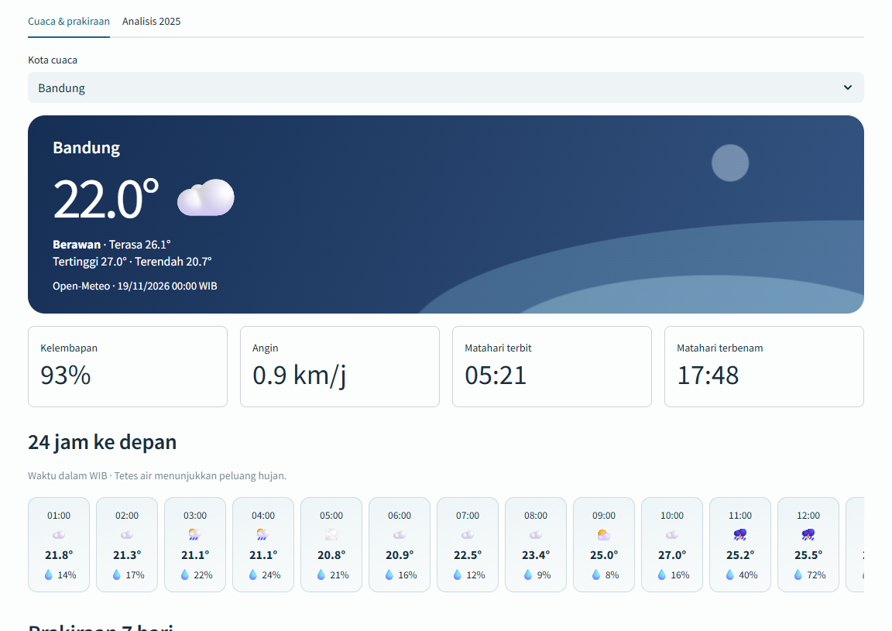
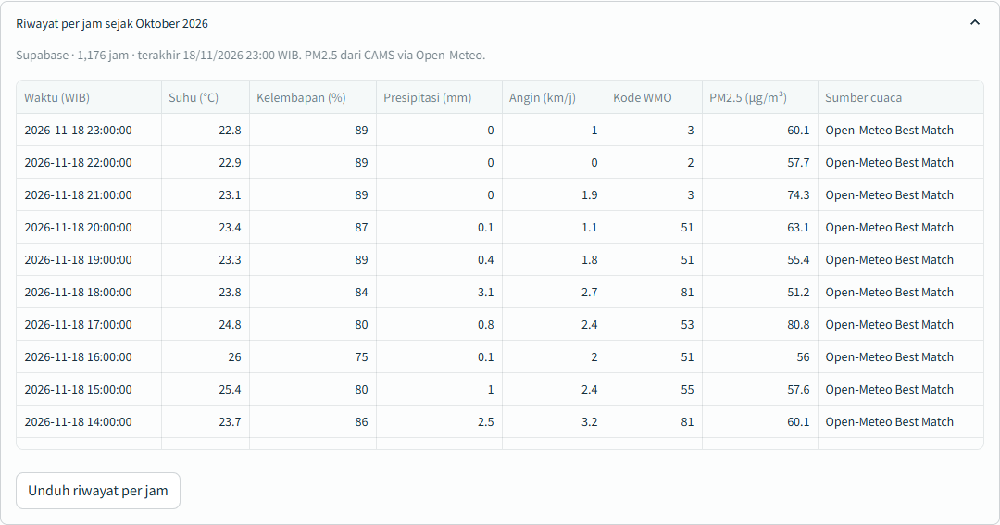
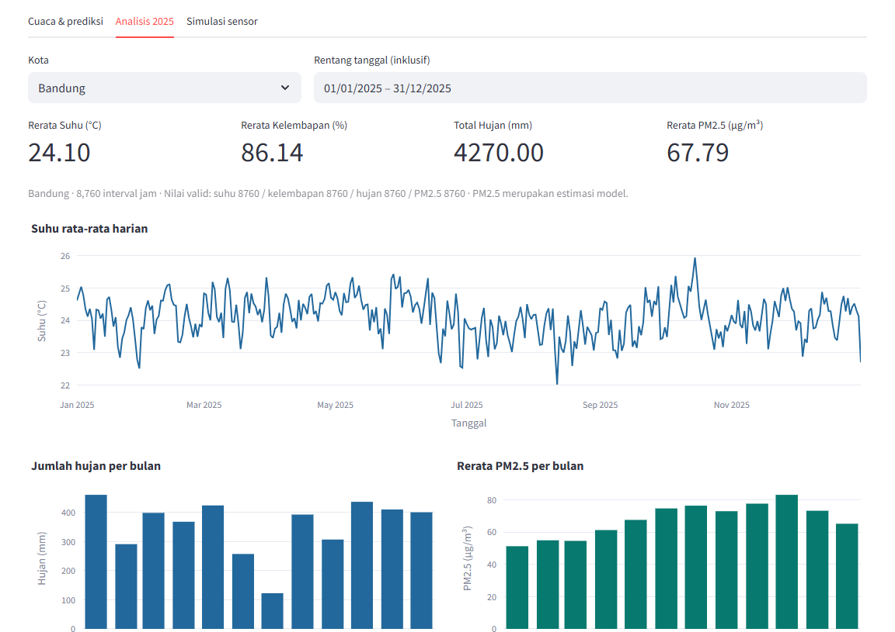
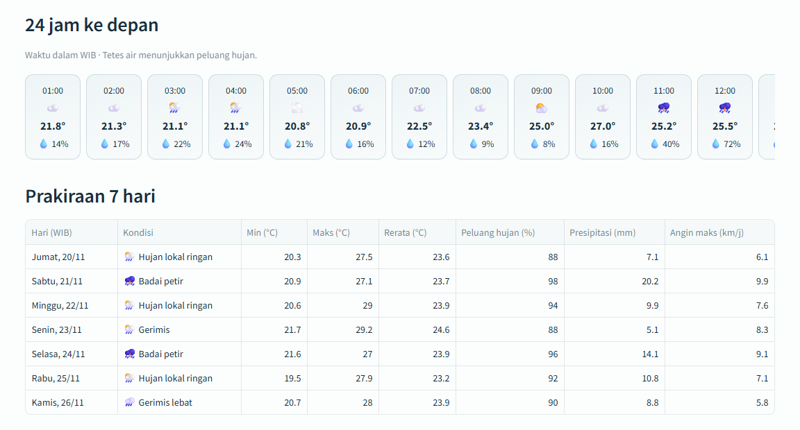

# Dashboard Cuaca Kota Berbasis Cloud

*Laporan Kemajuan Minggu 2 · Telematika · 19 November 2026*
*Studi Bandung dengan pembanding Jakarta dan Surabaya · Topik 6, Smart City Dashboard Sederhana*

| Anggota | NPM | Kelas |
|---|---|---|
| Noell Valentino Timothy | 140810240064 | B |
| Sebastian Augustino Lie | 140810240076 | B |
| Newten Putra Santoso | 140810240090 | B |

Teknik Informatika, FMIPA Universitas Padjadjaran

## 1. Latar belakang

Minggu ini kami menggabungkan prakiraan cuaca dan arsip tiga kota dalam satu dashboard. Saat aplikasi dibuka, pengguna langsung melihat cuaca Bandung dan peluang hujan beberapa jam ke depan. Untuk pertanyaan seperti “bulan apa yang paling basah di Bandung?”, pengguna dapat membuka tab Analisis 2025 dan membandingkannya dengan Jakarta dan Surabaya.

*Gambar 1. Tampilan Bandung pada 19 November dini hari. Kartu utama mencantumkan jam data dalam WIB. Deretan di bawahnya bisa digeser sampai 24 jam ke depan.*

## 2. Tujuan dan ruang lingkup

Pengguna bisa memilih kota, melihat kondisi sekarang, membandingkan prakiraan tujuh hari, dan mengunduh riwayat per jam. Untuk analisis, kami meninjau bulan terbasah dan terkering, perbedaan suhu antarkota, hubungan suhu dengan kelembapan, serta hubungan hujan dengan PM2.5. Satu koordinat mewakili setiap kota. Hujan di kecamatan tertentu bisa berbeda dari angka yang tampil.

## 3. Data yang digunakan

Arsip 2025 berisi 8.760 jam per kota atau **26.280 baris**. Kami memakainya untuk membandingkan pola suhu, kelembapan, hujan, dan PM2.5 selama setahun. Prakiraan tiap kota berasal dari Weather Forecast API Open-Meteo [1]. Arsip cuaca 2025 memakai reanalisis ERA5 melalui Historical Weather API [2].

Di Supabase, tabel `cuaca_online` berisi **3.528 baris** dari 1 Oktober 2026 pukul 00.00 sampai 18 November 2026 pukul 23.00 WIB. Ketiga kota punya 49 hari lengkap. Tabel berikut merangkum impor sampai 18 November.

| Kota | Jam tersedia | Rerata suhu (°C) | Rerata estimasi PM2.5 (µg/m³) |
|---|---:|---:|---:|
| Bandung | 1.176 | 24,90 | 88,02 |
| Jakarta | 1.176 | 29,01 | 100,04 |
| Surabaya | 1.176 | 29,93 | 51,65 |

Angka pada tabel mewakili periode 49 hari tersebut. Riwayat cuaca memakai ERA5 untuk tanggal lama dan model operasional untuk tujuh tanggal terkini saat impor. PM2.5 merupakan estimasi Copernicus Atmosphere Monitoring Service (CAMS) yang kami ambil melalui Air Quality API [3]. Kolom sumber ikut disimpan sehingga satu baris bisa ditelusuri kembali. [Data per jam yang dipakai dalam laporan](../data/riwayat_online.csv)

*Gambar 2. Panel riwayat memuat waktu, satuan, dan sumber cuaca. Tombol unduh mengikuti kota yang dipilih.*

## 4. Alat dan arsitektur sistem

| Alur | Yang terjadi |
|---|---|
| Buka aplikasi | Streamlit meminta kondisi terkini dan prakiraan ke Open-Meteo. Hasil untuk kota yang sama dipakai kembali selama 15 menit. |
| Perbarui riwayat | Python mengambil data cuaca dan kualitas udara. Aplikasi terhubung ke PostgreSQL di Supabase lewat session pooler [4]. Tabel menyimpan satu baris per kota dan waktu. Impor ulang memperbarui baris yang sama. |
| Baca dan analisis | Kami memakai pandas untuk menghitung ringkasan per kota [5] dan Plotly untuk menggambar grafik interaktif [6]. Saat riwayat cloud belum bisa dibaca, aplikasi memakai salinan CSV dan menampilkan sumbernya. |
| Kirim pengukuran IoT | Penerima HTTP memeriksa token serta isi kiriman, lalu menyimpan pembacaan perangkat di tabel tersendiri, `cuaca_sensor`. |

Dengan alur ini, membuka dashboard memperbarui tampilan prakiraan. Untuk memperpanjang riwayat Supabase, perintah impor dijalankan tersendiri. Berkas dan petunjuk menjalankannya ada di [README](../README.md).

## 5. Langkah pengerjaan dan hasil analisis

Kami menyamakan waktu ke WIB dan memeriksa pasangan kota–waktu sebelum menghitung statistik. Untuk membandingkan hujan dengan PM2.5, kami memakai bulan yang lengkap agar potongan awal atau akhir bulan tidak dibaca sebagai bulan kering.

| Kota | Suhu rata-rata 2025 | Hujan setahun | Bulan terbasah | Bulan terkering |
|---|---:|---:|---|---|
| Bandung | 24,10 °C | 4.270,0 mm | Januari · 460,6 mm | Juli · 122,6 mm |
| Jakarta | 27,41 °C | 2.348,0 mm | Januari · 359,0 mm | Juli · 48,6 mm |
| Surabaya | 28,20 °C | 2.249,9 mm | Mei · 443,7 mm | Juli · 16,0 mm |

**Juli menjadi bulan terkering di ketiga kota**, tetapi puncak hujan Surabaya terjadi pada Mei. Selisih suhu rata-rata terbesar terdapat antara Surabaya dan Bandung, sekitar **4,10 °C**. Saat memilih rentang tanggal yang lebih pendek, hasil di kartu dan tabel akan mengikuti periode baru tersebut.

*Gambar 3. Bandung selama 2025. Grafik harian memperlihatkan perubahan yang tertutup jika hanya melihat satu rata-rata tahunan.*

Di Bandung, suhu dan kelembapan rata-rata harian memiliki korelasi Pearson **−0,503** dari 365 pasangan hari. Hari yang lebih hangat cenderung memiliki kelembapan relatif lebih rendah. Untuk total hujan dan PM2.5 bulanan, korelasinya **−0,286 di Bandung, −0,634 di Jakarta, dan +0,416 di Surabaya**. Dengan 12 pasangan bulan per kota dan arah hubungan yang berbeda, data ini belum cukup untuk menyimpulkan bahwa hujan menyebabkan perubahan PM2.5.

*Gambar 4. Setiap titik di grafik pertama mewakili satu hari. Pada grafik kedua, satu titik mewakili satu bulan penuh.*

## 6. Dashboard dan unsur telematika

**Prakiraan operasional.** Saat halaman Bandung dibuka pada 19 November dini hari, suhu udara sekitar 22 °C. Kartu utama juga memuat suhu terasa, sedangkan empat kartu di bawahnya merangkum kelembapan, angin, matahari terbit, dan matahari terbenam. Tabel prakiraan menunjukkan tujuh tanggal berikutnya sesuai waktu pembaruan Open-Meteo.

*Gambar 5. Untuk memilih waktu kegiatan, pengguna dapat membaca peluang hujan per jam. Untuk membandingkan hari, tabel juga memuat suhu minimum, maksimum, jumlah presipitasi, dan angin maksimum.*

## 7. Jadwal dan pembagian tugas

| Pekerjaan minggu ini | Hasil |
|---|---|
| Pengambilan dan penyimpanan data | Riwayat Oktober–November tiga kota tersimpan di Supabase dengan kunci kota dan waktu. |
| Penyusunan dashboard | Dua tab memisahkan prakiraan yang terus diperbarui dari analisis arsip 2025. |
| Pengujian dan dokumentasi | Ringkasan dashboard diperiksa terhadap hasil hitungan Pandas. Lima tangkapan layar mencatat tampilan saat pengujian. |

Pembagian peran mengikuti rencana tim. Newten berfokus pada pengolahan data dan analisis, Sebastian pada dashboard dan publikasi, serta Noell pada pengujian dan dokumentasi.

## 8. Pengujian dan hasil

| Pemeriksaan | Hasil |
|---|---|
| Filter kota dan tanggal | Empat indikator × tiga kota × empat periode menghasilkan 48 nilai yang cocok dengan hitungan Pandas sampai dua desimal. [Hasil per indikator](../bukti/uji_indikator.csv) |
| Cloud dan IoT | Ketiga kota terbaca dari Supabase. Uji penerima HTTP mencakup kiriman sah, token salah, kelembapan di luar rentang, kiriman ulang, dan konflik data pada waktu yang sama. Pengujian menggunakan pengirim perangkat lunak. |

Tangkapan layar diambil dari aplikasi yang berjalan di browser dengan koneksi ke Supabase. Pengujian dengan perangkat fisik, umpan balik dua pengguna, serta akses melalui URL hosting publik belum dicatat dalam pengujian akhir ini.

## 9. Keamanan, etika, dan batas penggunaan

URI database berada di pengaturan rahasia pada mesin yang menjalankan aplikasi. Token perangkat digunakan untuk mengirim pembacaan ke penerima HTTP. Riwayat daring dan kiriman perangkat memiliki tabel masing-masing sehingga data model cuaca tidak tercampur dengan pengukuran lapangan. Penyimpanan kredensial mengikuti panduan pengelolaan secrets Streamlit [7]. Pada dashboard, kami mencantumkan Open-Meteo dan CAMS sebagai sumber data, beserta lisensi CC BY 4.0 [8].

## 10. Daftar pustaka

[1] Open-Meteo, “Weather Forecast API.” [Daring]. Tersedia: [https://open-meteo.com/en/docs](https://open-meteo.com/en/docs). Diakses: 19 Nov. 2026.

[2] Open-Meteo, “Historical Weather API.” [Daring]. Tersedia: [https://open-meteo.com/en/docs/historical-weather-api](https://open-meteo.com/en/docs/historical-weather-api). Diakses: 19 Nov. 2026.

[3] Open-Meteo, “Air Quality API.” [Daring]. Tersedia: [https://open-meteo.com/en/docs/air-quality-api](https://open-meteo.com/en/docs/air-quality-api). Diakses: 19 Nov. 2026.

[4] Supabase, “Connect to your database.” [Daring]. Tersedia: [https://supabase.com/docs/guides/database/connecting-to-postgres](https://supabase.com/docs/guides/database/connecting-to-postgres). Diakses: 19 Nov. 2026.

[5] The pandas development team, “pandas documentation.” [Daring]. Tersedia: [https://pandas.pydata.org/docs/](https://pandas.pydata.org/docs/). Diakses: 19 Nov. 2026.

[6] Plotly, “Plotly Python Open Source Graphing Library.” [Daring]. Tersedia: [https://plotly.com/python/](https://plotly.com/python/). Diakses: 19 Nov. 2026.

[7] Streamlit, “Secrets management.” [Daring]. Tersedia: [https://docs.streamlit.io/develop/concepts/connections/secrets-management](https://docs.streamlit.io/develop/concepts/connections/secrets-management). Diakses: 19 Nov. 2026.

[8] Creative Commons, “Attribution 4.0 International (CC BY 4.0).” [Daring]. Tersedia: [https://creativecommons.org/licenses/by/4.0/](https://creativecommons.org/licenses/by/4.0/). Diakses: 19 Nov. 2026.
